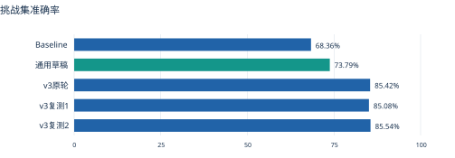
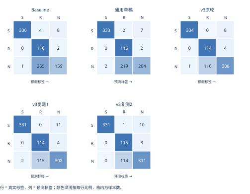
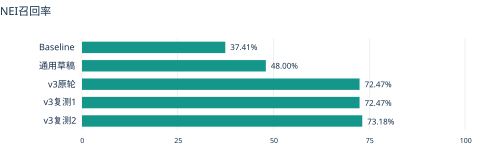
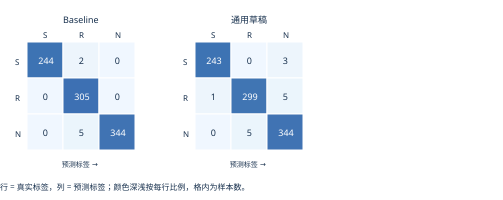

# 事实判断PJ阶段进展

## Baseline、通用提示词与v3的组内分享版

这份报告用于同步目前做到了什么、卡在哪里，以及下一步如何验证。结果来自已有逐条预测的重新统计；不包含训练或LoRA实验。

统计快照：2026-10-29T10:36:53+08:00。S=支持，R=反驳，N=信息不足。

当前最清楚的结论：A组原始模板在挑战集为68.36%；增加一段通用判断原则后为73.79%，净多答对48条；加入机制规则的v3三轮为85.08%～85.54%。总分改善主要来自NEI误判减少，但仍有大量证据不足被误判为反驳。

| 版本 | 挑战集正确数 | Accuracy | Macro-F1 | 基础集 |
| --- | --- | --- | --- | --- |
| Baseline | 605/885 | 68.36% | 0.6591 | 893/900 (99.22%) |
| 通用草稿 | 653/885 | 73.79% | 0.7110 | 886/900 (98.44%) |
| v3原轮 | 756/885 | 85.42% | 0.8229 | 尚未评测 |
| v3复测1 | 753/885 | 85.08% | 0.8204 | 尚未评测 |
| v3复测2 | 757/885 | 85.54% | 0.8250 | 尚未评测 |

需要注意的代价：通用版基础集为98.44%，相对Baseline的99.22%净少答对7条，变化-0.78个百分点。挑战集收益与基础能力回退应一起报告。

v3三轮是同一885条样本的重复请求，不是三个独立测试集。全量结果包含网络失败处理；主跑分数及恢复数量另列。未完成的基础集不报最终准确率。

# 我们具体比较了什么

| 维度 | Baseline | 通用草稿 | v3 |
| --- | --- | --- | --- |
| 任务说明 | A组原始模板 | 完整保留原始模板 | 完整保留原始任务定义 |
| 新增指导 | 无额外指导 | 一段统一的逻辑与证据原则 | 三项反驳检查及机制规则 |
| 专项规则 | 无 | 无 | 否认、人物、时间、名单及范围 |
| 示例数量 | 0 | 0 | 0 |
| 推理调用 | 每样本一次 | 每样本一次 | 每样本一次；复测独立计分 |
| 输入字段 | evidence和claim | evidence和claim | evidence和claim |

统一配置：服务模型名qwen38-27b；temperature=0；enable_thinking=false；max_tokens=4096；并发4。原始标签、证据和陈述未改。group、mechanism、gold等不输入模型，只用于离线统计。

## 通用版新增内容的中文含义

依据证据陈述的事实及其必然逻辑结果判断整个陈述；区分已建立事实与额外假设；尊重限定词的含义和范围；缺少支持不构成反驳；支持与反驳均未建立时选择NEI；每条输入使用同一标准。

v3进一步写明：反驳前找出事实依据、检查推导假设、尝试证据与陈述能否同时成立；区分他人否认与事实否定、其他人获奖与主体没获奖、某次发生与首次/唯一发生，并保留完整名单的有效排除力。

## 数据与评测边界

挑战集885条：S 342、R 118、N 425，共143个group。基础集900条：S 246、R 305、N 349，共105个group。两份集合分别计分，不能合并成一个总分。

数据复核状态：挑战集885条的human_review_status为adjudicated；基础900条该字段为pending。本轮沿用A组标签计分，未重新完成基础集人工裁决。

所有三类Recall、Precision、F1均给出。Macro-F1是三类F1的平均值。失败不从总分分母删除；本文最终网络恢复分数只替换请求级网络失败，绝不按答案正确与否挑选重跑。

A方参考部署是Q8_0，当前服务量化尚未独立核实，不能把与A方66.67%参考分的差异归因于提示词或某一种量化。现有挑战集已经参与错误分析，结果属于开发评估；zero-shot仅表示没有示例，并不表示提示词未优化。

# 混淆矩阵看错误流向

每个矩阵均覆盖挑战集885条。观察N行R列：这是“信息不足被判成反驳”的数量；观察R行N列：这是过度谨慎可能带来的反向损失。

Baseline：N→R 265/425；R→N 2/118；S→N 8/342。

通用草稿：N→R 219/425；R→N 2/118；S→N 7/342。

v3原轮：N→R 116/425；R→N 4/118；S→N 8/342。

v3的反驳召回仍然较高，但预测为反驳时的精确率只有约一半。这意味着“能抓到真反驳”和“判成反驳就可信”是两件不同的事，不能只看REFUTES Recall。

# 各类别指标逐项列出

| 版本 | 标签 | 样本数 | Precision | Recall | F1 |
| --- | --- | --- | --- | --- | --- |
| Baseline | S | 342 | 99.70% | 96.49% | 0.9807 |
| Baseline | R | 118 | 30.13% | 98.31% | 0.4612 |
| Baseline | N | 425 | 94.08% | 37.41% | 0.5354 |
| 通用草稿 | S | 342 | 99.40% | 97.37% | 0.9838 |
| 通用草稿 | R | 118 | 34.42% | 98.31% | 0.5099 |
| 通用草稿 | N | 425 | 95.77% | 48.00% | 0.6395 |
| v3原轮 | S | 342 | 99.70% | 97.66% | 0.9867 |
| v3原轮 | R | 118 | 49.57% | 96.61% | 0.6552 |
| v3原轮 | N | 425 | 96.25% | 72.47% | 0.8268 |
| v3复测1 | S | 342 | 99.40% | 96.78% | 0.9807 |
| v3复测1 | R | 118 | 49.78% | 96.61% | 0.6571 |
| v3复测1 | N | 425 | 95.36% | 72.47% | 0.8235 |
| v3复测2 | S | 342 | 100.00% | 96.78% | 0.9837 |
| v3复测2 | R | 118 | 50.00% | 97.46% | 0.6609 |
| v3复测2 | N | 425 | 95.99% | 73.18% | 0.8304 |

Precision：预测为该类的样本中有多少是真的。Recall：真实该类样本中找回多少。F1综合考虑两者；标签N即NOT ENOUGH INFO。

# 不同困难机制的结果

## 准确率

| 机制 | 条数 | Baseline | 通用草稿 | v3原轮 | v3复测1 | v3复测2 |
| --- | --- | --- | --- | --- | --- | --- |
| 指代归属 | 100 | 61.00% | 64.00% | 74.00% | 71.00% | 74.00% |
| 否认与事实 | 192 | 66.15% | 73.96% | 98.96% | 98.96% | 98.44% |
| 相似人物 | 174 | 54.02% | 60.92% | 75.86% | 75.29% | 77.01% |
| 时间与预设 | 144 | 72.92% | 79.17% | 80.56% | 81.25% | 81.25% |
| 名单封闭范围 | 76 | 88.16% | 89.47% | 92.11% | 90.79% | 92.11% |
| 任期与时间范围 | 80 | 83.75% | 85.00% | 95.00% | 93.75% | 92.50% |
| 唯一性 | 119 | 70.59% | 76.47% | 82.35% | 84.03% | 83.19% |

## NEI召回率

| 机制 | 条数 | Baseline | 通用草稿 | v3原轮 | v3复测1 | v3复测2 |
| --- | --- | --- | --- | --- | --- | --- |
| 指代归属 | 100 | 2.50% | 10.00% | 35.00% | 27.50% | 35.00% |
| 否认与事实 | 192 | 32.29% | 47.92% | 98.96% | 98.96% | 96.88% |
| 相似人物 | 174 | 17.05% | 29.55% | 54.55% | 54.55% | 57.95% |
| 时间与预设 | 144 | 15.22% | 34.78% | 39.13% | 41.30% | 41.30% |
| 名单封闭范围 | 76 | 80.00% | 82.86% | 91.43% | 88.57% | 94.29% |
| 任期与时间范围 | 80 | 72.92% | 75.00% | 91.67% | 89.58% | 87.50% |
| 唯一性 | 119 | 58.33% | 65.28% | 79.17% | 84.72% | 81.94% |

机制标签仅用于离线拆分，未作为输入。不同机制的NEI样本占比不同，因此不能把机制准确率直接当成NEI召回率。完整机制级三类Precision/Recall/F1另附CSV。

通用版相对Baseline在七个机制上的净增正确数依次为：指代+3、否认+15、相似人物+12、时间预设+9、名单范围+1、任期时间+1、唯一性+7。各机制总分均未下降，但个别样本仍有退步，不能把净提升解释为没有损失。

三轮始终错90条中：相似人物24、时间与预设22、指代归属22、唯一性13、名单范围5、任期与时间3、否认与事实1。这些是v3三轮的交集错误，并非通用版的错误分布。

# 改善了哪些 又损失了哪些

| 相对Baseline | 纠正错题 | 原对变错 | 净增正确 | 预测一致 |
| --- | --- | --- | --- | --- |
| 通用草稿 | 56 | 8 | +48 | 817/885 |
| v3原轮 | 163 | 12 | +151 | 708/885 |
| v3复测1 | 159 | 11 | +148 | 713/885 |
| v3复测2 | 164 | 12 | +152 | 709/885 |

## v3稳定性与90%目标

| 比较 | 预测一致率 | 纠正 | 退步 | 净变化 |
| --- | --- | --- | --- | --- |
| 原v3 vs 复测1 | 93.56% | 27 | 30 | -3 |
| 原v3 vs 复测2 | 94.24% | 26 | 25 | +1 |
| 复测1 vs 复测2 | 93.90% | 29 | 25 | +4 |

三轮有81条样本预测发生变化，90条三轮都错，其中82条金标准为NEI。三轮总分范围只有0.46个百分点，但逐条预测一致率约94%，总分稳定不等于每道题稳定。

三轮多数票757/885（85.54%），没有超过最好单轮。利用真实标签事后挑选三轮中正确答案可覆盖795/885（89.83%）；它不可部署，只是三轮现有答案的正确覆盖数。至少90%需要797/885，最好单轮还需净多答对40条。

## 网络恢复与主跑口径

| 轮次 | 主跑正确 | 网络失败 | 恢复后正确 |
| --- | --- | --- | --- |
| Baseline | 605/885 | 0 | 605/885 |
| 通用版 | 653/885 | 0 | 653/885 |
| v3原轮 | 756/885 | 1 | 756/885 |
| v3复测1 | 744/885 | 13 | 753/885 |
| v3复测2 | 755/885 | 2 | 757/885 |

# 困难样本 从否认到人物归属

## 已经改善的例子：他人否认不等于事实为假

证据原文：Her personal assistant dismissed as baseless the reports that Brandi Carlile had secretly adopted a rescue dog named Whiskey.

陈述原文：Brandi Carlile secretly adopted a rescue dog named Whiskey.

中文理解：助理把“Brandi Carlile秘密收养了一只叫Whiskey的救助犬”的报道斥为毫无根据。 陈述：Brandi Carlile秘密收养了这只犬。

金标准=N；Baseline=R；通用草稿=N；v3原轮=N

证据建立的是助理作出否认，没有独立建立事件未发生。这类提醒在通用版里已经能改善部分样本。

样本ID：e_8cd325ba12347b9a

## 仍然困难：同姓被补成同一家族

证据原文：John Faithfull is the only one in the family who won a Grammy Award for Best New Artist.

陈述原文：Marianne Faithfull won a Grammy Award for Best New Artist.

中文理解：John Faithfull是其家族中唯一获得该格莱美奖的人。 陈述：Marianne Faithfull获得了该奖。

金标准=N；Baseline=R；通用草稿=R；v3原轮=R

“唯一”只在该家族内生效。文本没有证明Marianne属于该家族；同姓不能提供这个前提。

样本ID：e_de5850002a981ff4

## 仍然困难：指代正确 结论却越界

证据原文：Melania Trump and her brother Miha Knavs attended a private university in Ljubljana in 1992. In 1995, he won a national architecture award.

陈述原文：Melania Trump won a national architecture award in 1995.

中文理解：Melania Trump与兄弟Miha Knavs于1992年在卢布尔雅那就读。1995年，他获得一项全国建筑奖。 陈述：Melania Trump在1995年获得该奖。

金标准=N；Baseline=R；通用草稿=R；v3原轮=R

即使he正确指向兄弟，也只证明兄弟获奖；尚未排除Melania也获奖。

样本ID：e_7325d6294ac00a1a

# 困难样本 从时间到集合范围

## 仍然困难：某年获奖被当成首次获奖

证据原文（节选）：Tim Burton won the Academy Award for Best Animated Feature in 2023.

陈述原文：Tim Burton had won the Academy Award for Best Animated Feature before 2023.

中文理解：Tim Burton于2023年获奖。 陈述：Tim Burton在2023年以前获过该奖。

金标准=N；Baseline=R；通用草稿=R；v3原轮=R

2023年一次获奖与更早另一次获奖可以共存。不能自行补出“首次”或“只有一次”。

样本ID：e_e4d322f586379996

## 仍然困难：首段任期被当成全部任期

证据原文：Shuntaro Furukawa first served as president of Nintendo from 2015 to 2023.

陈述原文：In 2025, Shuntaro Furukawa served as president of Nintendo.

中文理解：Shuntaro Furukawa首次担任任天堂总裁的任期为2015至2023年。 陈述：他在2025年担任任天堂总裁。

金标准=N；Baseline=R；通用草稿=R；v3原轮=R

first served限定首次任期，没有排除后来再次任职。模型多次在复述时漏掉first。

样本ID：e_3af48c4e223c3693

## 仍然困难：子集名单被扩大为全集

证据原文（节选）：Jim Harbaugh has two children born in the 1990s: Carter and Bryson.

陈述原文：Lindsey is one of Jim Harbaugh's children.

中文理解：Jim Harbaugh有两名出生于1990年代的孩子：Carter和Bryson。 陈述：Lindsey是他的孩子之一。

金标准=N；Baseline=R；通用草稿=R；v3原轮=R

证据只封闭出生于1990年代的子集；Lindsey可能出生于其他年代。

样本ID：e_107863750565aa1a

# 标注边界与下一步

## 需要单独讨论：范围缺口与金标准

证据原文（节选）：Hegseth's two co-hosts are Maria Bartiromo and Katie Pavlich.

陈述原文：Brian Kilmeade is one of Pete Hegseth's co-hosts on Fox & Friends Weekend.

中文理解：证据给出两名共同主持人，但长证据未明确节目名称。 陈述：Brian Kilmeade是他在Fox & Friends Weekend的共同主持人之一。

金标准=R；Baseline=R；通用草稿=R；v3原轮=N

金标准为REFUTES；v3认为节目范围没有确立而选NEI。它体现限定范围与标注口径的边界争议。保留金标准照常计错，不为提高分数改标签；需要组内和A组一起核对。

样本ID：e_c802018beea08dd8

## 目前真正卡住的地方

模型往往能找到原文、解析人名或日期，但在推出否定结论时仍偷偷加入“只有一个”“同一家族”“只发生一次”等前提；增加一般性提醒改善了一部分，尚未消除这些固定误判。

## 下一步建议

通用版基础集已发现净少答对7条，应先复核退步样本，并补做v3基础集。保留A组原模板作固定baseline、v3作已有强对照；每次只调整一个通用推理环节，并记录纠正与退步。若继续做90%目标，需要实际达到797条正确，不能由85%左右的重复分数外推。

当前885条挑战集已经用于调优，新增独立盲测数据更适合检验迁移；按group隔离同一场景变体。LoRA尚未启动，是否需要训练应由剩余错例和新数据表现决定。

# 基础能力与可复核附件

通用版基础集886/900（98.44%），相对Baseline净变化-7条，准确率变化-0.78个百分点。该结果用于检查通用指导是否牺牲基础判断能力。

| 版本 | 正确数 | Accuracy | Macro-F1 |
| --- | --- | --- | --- |
| Baseline | 893/900 | 99.22% | 0.9925 |
| 通用草稿 | 886/900 | 98.44% | 0.9851 |

| 版本 | 标签 | Precision | Recall | F1 |
| --- | --- | --- | --- | --- |
| Baseline | S | 100.00% | 99.19% | 0.9959 |
| Baseline | R | 97.76% | 100.00% | 0.9887 |
| Baseline | N | 100.00% | 98.57% | 0.9928 |
| 通用草稿 | S | 99.59% | 98.78% | 0.9918 |
| 通用草稿 | R | 98.36% | 98.03% | 0.9819 |
| 通用草稿 | N | 97.73% | 98.57% | 0.9815 |

# 基础能力分项与附件

## 基础集各机制准确率

| 机制 | 样本数 | Baseline | 通用草稿 |
| --- | --- | --- | --- |
| BOUND | 240 | 100.00% | 100.00% |
| FUNCTIONAL | 60 | 96.67% | 98.33% |
| IMPLICATIVE | 165 | 100.00% | 99.39% |
| PLACE | 45 | 100.00% | 100.00% |
| PLAN | 75 | 98.67% | 94.67% |
| RELDATE | 90 | 98.89% | 98.89% |
| TIMESHIFT | 225 | 98.67% | 96.89% |

v3基础900条尚未评测，因此还不能确认v3在基础任务上是否回退。机制级Macro-F1固定对三类取平均；某机制没有某一类时，该类F1按原评分器记0，不宜与全体三类齐全的Macro-F1直接横比。

## 附件提供什么

逐条预测对照.csv：1785条样本，一行一题，含完整证据、陈述、金标准、Baseline/通用/v3三轮预测；未评测字段留空。另有总体指标、机制级全指标、所选错例全文与理由，以及三种提示词原文。

来源：A组原数据包benchmark_1011(1).zip；results/full-4096-20261027；results/general-full-20261029；v3原轮及两次复测目录。完整源文件SHA256见指标与来源快照.json。分享包不包含密钥、请求头或.env。
